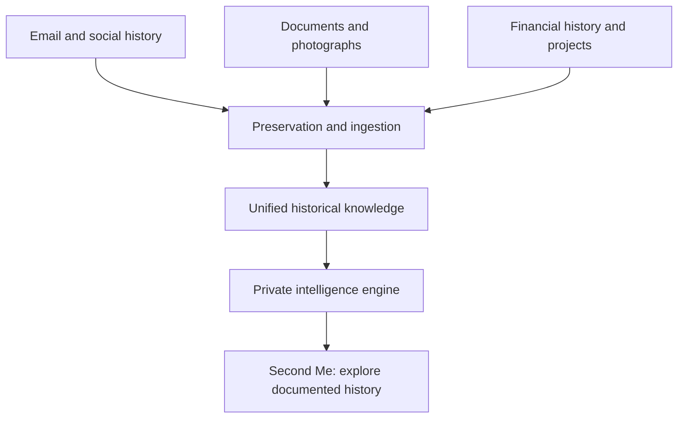
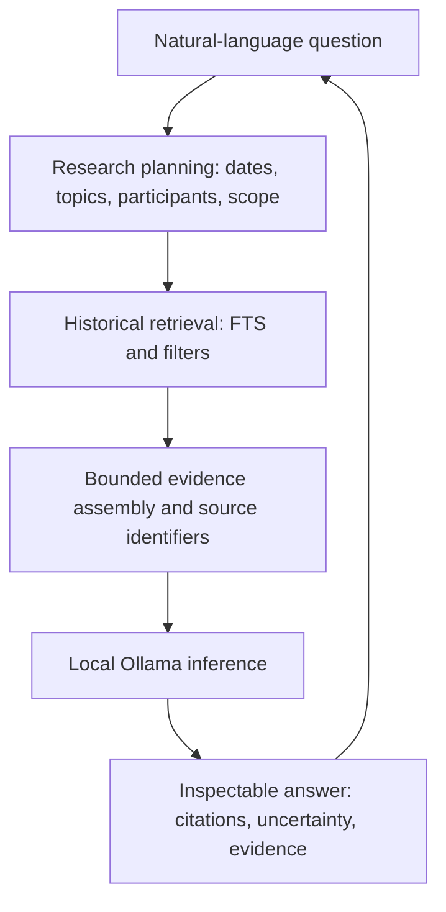
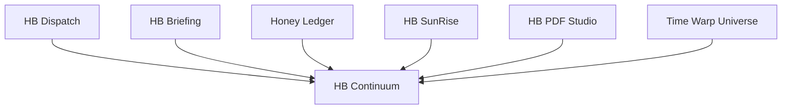
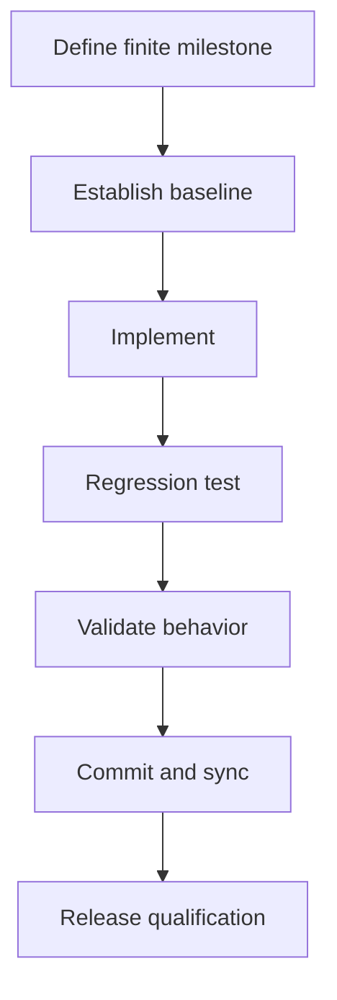
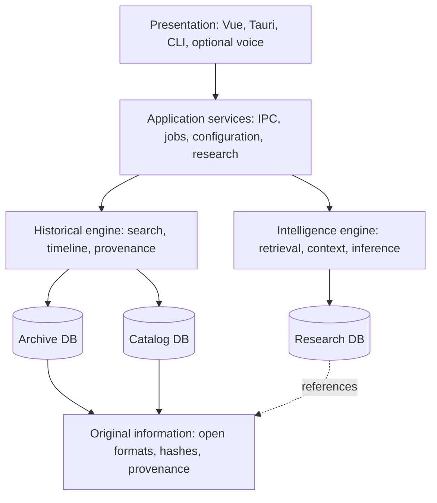

# HB Continuum — Comprehensive Development Roadmap

*Time is linear. Knowledge need not be.*

**The intelligence is replaceable. The memories are yours.**

This is the long-term development roadmap for HB Continuum, from its origins as HB Dispatch to a mature, private, local-first historical intelligence workstation. The established baseline is [v0.4.0-beta](https://github.com/James-HoneyBadger/HB_Continuum/releases/tag/v0.4.0-beta). Version numbers are proposed engineering milestones, not promises or delivery dates. Consult [implementation status](engineering/IMPLEMENTATION_STATUS.md) and the current source before assigning work; do not repeat completed milestones.

## 1. The ultimate vision

Continuum should become a personally controlled repository of an individual's documented history, capable of preserving, organizing, searching, connecting and intelligently interpreting information accumulated throughout a lifetime. It is more than an email client, document manager, chatbot or personal knowledge manager: it is an environment for exploring one's documented existence.

Preservation retains original records, provenance and integrity. Unified knowledge supplies search, timelines, relationships and evidence. Private intelligence supplies retrieval, local inference and evidence attribution.

## 2. Master release roadmap

| Milestone | Theme | Objective |
| --- | --- | --- |
| v0.1–v0.2 | Origins | HB Dispatch and foundational email preservation |
| v0.3 | Preservation | Operational email archival and research infrastructure |
| v0.4 | Historical Knowledge | Source-independent historical research workstation; released beta baseline |
| v0.5 | Intelligence | Evidence-grounded conversational research through local AI |
| v0.6 | Expansion | Comprehensive document, media and historical information ingestion |
| v0.7 | Interoperability | Optional Honey Badger Universe and external application integration |
| v0.8 | Historical Understanding | Deep chronology, identity resolution, longitudinal research and historical profiles |
| v0.9 | Second Me | Comprehensive conversational interface to documented history |
| v1.0 | Continuum | Mature, dependable personal historical intelligence workstation |
| v2.0+ | Digital Legacy | Long-term preservation, family history and intergenerational continuity |

# Part I — The archival foundation

## 3. v0.1–v0.3: HB Dispatch and preservation

**Status: established.** The original purpose was digital sovereignty over personal correspondence.

| Capability | Established foundation |
| --- | --- |
| Email ingestion | Read-only IMAP retrieval |
| Original preservation | EML files |
| Deduplication | SHA-256 hashes |
| Local database | SQLite |
| Search | FTS5 |
| Provenance | Account and mailbox origins |
| Synchronization | Manual and scheduled |
| Research | Tags, classifications, saved searches |
| Recovery | Backup, restoration and verification |
| Interface | CLI and Tkinter |

> Your email provider should be your communications service, not the permanent custodian of your correspondence.

Dispatch remains the identifiable communications ingestion engine within Continuum and should remain independently useful wherever appropriate.

## 4. v0.4 — Historical Knowledge Update

**Status: released beta baseline.** This milestone expands the project beyond email.

| Subsystem | Capability |
| --- | --- |
| Source-independent catalog | Historical records independent of email |
| Facebook ingestion | Posts, messages, comments, events, media metadata and reactions |
| Unified search | Email and Facebook records together |
| Advanced search | Nested Boolean query construction |
| Timeline | Historical chronological exploration |
| Relationships | Documented participant associations |
| Collections | User-organized source evidence |
| Journal | Revision-tracked personal annotations |
| Reports | Markdown, HTML and structured exports |
| Health | Integrity checking and index repair |
| Recovery | Validated multi-database backup and restoration |
| Local AI | Optional Ollama summarization |
| Desktop | Integrated Tauri 2 and Vue 3 workspaces |

The foundation consists of Python, Rust, Vue, SQLite, versioned IPC and substantial regression testing. The beta is source-only; consult the qualification record for verification scope and limitations.

# Part II — The intelligence foundation

## 5. v0.5 — The Intelligence Update

**Primary development priority.** Make historical information intelligently accessible through natural-language research.

### 5.1 Scalable retrieval

Replace the baseline 5,000-candidate unified search limitation with properly paginated retrieval. Support deterministic ordering, accurate counts where available, advanced filtering, cancellation, source-specific retrieval and bounded memory. Demonstrate retrieval beyond the former ceiling without omissions or duplicates. Do not simply increase the limit. If current implementation has already addressed this, verify it rather than reimplementing it.

### 5.2 Historical question-answering engine

Implement an independent intelligence service that interprets questions, retrieves relevant records, assembles bounded evidence, invokes Ollama and produces answers with inspectable references.

Keep retrieval, context construction, inference, citation validation and presentation independently testable. Never dump an entire archive into a model. Expose retrieval scope, omitted evidence and context limits.

### 5.3 Ollama intelligence infrastructure

Build on existing local inference: model discovery and selection, connection testing, streaming where supported, context-budget management, cancellation, timeouts, concurrency controls, conversation persistence and graceful degradation. Preserve loopback-only privacy safeguards. Do not automatically download large models. Ollama is optional; archival functionality must work without it.

### 5.4 Evidence attribution

Every substantial historical conclusion should reference actual source records. Distinguish documented facts, corroborated claims, reasonable inferences, contradictory information, uncertainty and missing evidence. Validate identifiers against supplied evidence; flag fabricated or unsupported citations. A valid identifier alone does not prove its source supports a claim. Preserve timestamps, excerpts, document page references where available and direct navigation to records.

### 5.5 Intelligence workspace

Create a fully integrated desktop workspace, not a disconnected demonstration. Include natural-language research, conversation history, date and source selection, scope controls, model status, evidence preview, streaming answer display, inspectable citations, cancellation and export. Integrate Search, Advanced Search, Timeline, Relationships, Collections, Journal and Reports. Users should be able to add supporting records to collections, save investigations and continue research.

Illustrative fictional interaction:

> **Question:** What were my principal interests during 2015?
>
> **Answer:** Selected records show recurring software development and photography activities. Project correspondence and development notes support the former; dated photography discussions support the latter. These records do not establish a complete account of your life.

The interface should let users inspect each cited record and refine the scope. This is a concept, not an existing functionality claim.

### 5.6 Release gate

Demonstrate conversational research on a synthetic historical archive with actual local inference, validated citations, preserved originals, graceful failure handling and regression coverage. Include conflicting evidence, insufficient information and embedded prompt-injection attempts. Without functioning evidence-grounded research, it is not an Intelligence Update.

# Part III — Source expansion

## 6. v0.6 — The Expansion Update

Expand email and social-history preservation into a broadly capable archival environment.

| Source | Intended capabilities |
| --- | --- |
| PDF | Text, metadata, page-level provenance |
| DOCX | Document content and metadata |
| Plain text | Notes, correspondence, historical writings |
| Markdown | Technical documentation and personal knowledge |
| CSV | Structured historical records |
| JSON | Application exports and structured datasets |
| Photographs | EXIF metadata, dates, locations, annotations |
| Audio | Metadata and optional local transcription |
| Video | Metadata and optional local transcription |
| Calendar exports | Historical appointments and events |
| Contacts | Participant information and historical associations |
| Browser bookmarks | Historical interests and research references |
| Software projects | Source files, project history, Git metadata |
| Social exports | Additional supported historical platforms |

### 6.1 Document intelligence

Provide searchable document contents, safe attachment extraction, page-level references, original preservation and explicit extraction limitations. Optional local OCR may support scanned documents, letters and handwriting where feasible. OCR output remains distinct from originals. Never execute macros or embedded instructions; bound extraction resources and handle malformed files.

### 6.2 Media preservation

Support configurable original-file preservation, external references, removable storage, hashes, thumbnails, metadata and missing-file detection. Do not necessarily duplicate every photograph or video. Users control storage policy.

### 6.3 Generalized source adapters

Document consistent interfaces for registration, ingestion, metadata, stable identifiers, verification, search, timeline participation and evidence references. Preserve previews, incremental ingestion, duplicate detection, cancellation and import history. Enable external FOSS contributors to add adapters without rewriting the application.

# Part IV — The Honey Badger ecosystem

## 7. v0.7 — The Interoperability Update

Continuum becomes a historical knowledge center without becoming a mandatory dependency for companion applications.

All connections are optional, explicit and versioned; this is not a claim of existing compatibility.

### 7.1 Interchange standard

Develop or extend applicable HB interchange standards. Support application identity, schema versions, stable identifiers, provenance, original timestamps, hashes, associated artifacts, metadata and explicit limitations. Favor a simple documented format that works over unnecessary enterprise complexity.

### 7.2 Application integration

| Application | Contribution |
| --- | --- |
| HB Dispatch | Communications and mailbox history |
| HB Briefing | Saved briefings and research products |
| Honey Ledger | Historical financial records |
| HB SunRise | Structured financial information |
| HB PDF Studio | Documents, extracted text and annotations |
| Time Warp Universe | Programs, creative artifacts and development history |
| Other HB applications | Explicitly exported records and project information |

Consume appropriate exports rather than reproduce companion application business logic. Continuum can research historical financial information without becoming an accounting engine. Do not fabricate compatibility where a suitable export contract does not exist.

### 7.3 External interoperability

Provide documented CLI, versioned IPC, local API, structured exports and potentially an optional MCP server with narrowly scoped read-only research capabilities. External AI access requires explicit user authorization and configurable information boundaries.

# Part V — Historical understanding

## 8. v0.8 — The Historical Understanding Update

Move beyond individual records toward understanding patterns across a lifetime.

### 8.1 Advanced chronological research

Support historical period analysis, overlapping events, multi-source timelines, recurring activities, uncertain dates and contextual event relationships. Users should be able to explore a period without remembering precise search terms.

### 8.2 Identity resolution

Develop user-controlled associations between different identifiers for the same person or organization, including multiple addresses, accounts and historical names. Associations must be inspectable, reversible and distinguish confirmed identities from suggested matches.

### 8.3 Historical relationship analysis

Explore documented communication patterns, organizational associations, shared projects and interaction frequency across years and sources. Never infer friendship, hostility, intimacy or motivation from frequency alone.

### 8.4 Topic evolution

Show how documented interests and activities develop over time. For example, compare recurring computing, historical research and photography references by period. Disclose record coverage, counting methods and the distinction between documented activity and personal interests. Do not treat uneven archive coverage as proof of changing preferences.

### 8.5 Historical profiles

Generate user-controlled, evidence-supported summaries of professional development, technical expertise, creative interests, projects, documented opinions, significant periods and changing intellectual pursuits. Include generation date, evidence scope, references and revision history.

### 8.6 Semantic retrieval

Add optional local embeddings and hybrid semantic/full-text retrieval where demonstrated to improve accuracy. Semantic matching supplements deterministic archival search. Embedding indexes remain optional and independently rebuildable.

# Part VI — Second Me

## 9. v0.9 — The Second Me Update

Second Me is not an imitation of the user, a simulated consciousness or autonomous personality. It is an intelligent interface to the individual's documented historical existence.

Illustrative future interaction:

> **Question:** How did my professional interests evolve from the beginning of my career through retirement?
>
> **Response:** Your archived records suggest several periods of professional development. I can reconstruct these using correspondence, employment records, technical documentation and personal writings. Some periods are better documented than others. Would you prefer a chronology, analysis of recurring interests, or comparison of early and later career?

Conclusions require actual supporting records.

### 9.1 Persistent historical intelligence

Provide independently stored research conversations, historical summaries, selected knowledge context, user-approved annotations and reusable investigations. Original records remain authoritative; intelligence is replaceable.

### 9.2 Historical perspective

Support questions spanning decades, not merely individual documents:

- What did I write about a subject twenty years ago?
- How did my documented opinions change?
- What projects occupied different periods?
- Which technical interests persisted?
- What experiences are documented as influencing a decision?
- What have I forgotten but preserved in correspondence?
- Which parts of my history are poorly documented?

### 9.3 Voice interface

Develop optional local speech-to-text, natural-language research, local text-to-speech and accessible hands-free exploration. Voice is an alternative interface to the same intelligence engine, not a separate intelligence system.

### 9.4 User-curated knowledge

Allow users to correct interpretations, supply missing context, confirm identity associations, annotate disputed records, exclude sensitive sources from AI and set research preferences. Corrections remain identifiable annotations rather than alterations to originals.

### 9.5 Intellectual development

Reconstruct documented intellectual development across decades: how interests emerged, evolved, converged, disappeared or returned. Treat results as interpretations of surviving records, not an objective psychological assessment.

# Part VII — Maturity

## 10. v1.0 — HB Continuum

The first stable major release should represent dependable integration of the fundamental Continuum concept.

| Area | Release requirement |
| --- | --- |
| Archival integrity | Dependable original preservation and verification |
| Search | Scalable and correctly paginated |
| Ingestion | Multiple dependable adapters |
| Research | Complete historical exploration workflows |
| Intelligence | Evidence-grounded local conversational research |
| Citations | Validated and inspectable sources |
| Privacy | Explicit information boundaries |
| Security | Documented threat model and reviewed safeguards |
| Encryption | Dependable protection strategy for sensitive archives |
| Backup | Validated complete recovery |
| Performance | Demonstrated large-archive operation |
| Desktop | Polished, consistent, accessible experience |
| Packaging | Dependable installation and upgrades |
| Documentation | Comprehensive practical guidance |
| Portability | Recoverable information independent of the application |

### 10.1 Cross-platform operation

Target dependable native macOS, Windows and Linux support; ARM64 and x86-64 where dependencies, packaging and verification permit. Test platform behavior rather than assuming portability from implementation languages.

### 10.2 Long-term archival safety

A personal archive may need to remain accessible for fifty years or longer. Favor documented open formats, exportable metadata, predictable migrations, independently inspectable originals and minimal proprietary dependencies. Users must recover information even if Continuum development ceases.

### 10.3 Security hardening

Document architecture for encryption, OS credential stores, least privilege, untrusted imports, prompt injection, backup protection, data deletion, local inference and external integration permissions. Never invent proprietary cryptography. Review mechanisms that could make records permanently inaccessible before introducing them.

# Part VIII — Digital legacy

## 11. v2.0 and beyond

### 11.1 Family Continuum

Support explicitly authorized family archives, genealogy, historical photographs, correspondence, oral histories and inherited documents. Individuals retain control over inclusion in shared history.

### 11.2 Digital legacy preservation

Provide selected legacy exports, inventories, access instructions, preservation manifests, explanatory narratives and independent archive readers. Distinguish ownership, copyright, consent, access rights and third-party privacy.

### 11.3 Organizational Continuum

Potentially support historical societies, research organizations, volunteers, family businesses, community groups and FOSS projects. Keep this optional; do not turn a personal workstation into an unnecessarily complex enterprise product.

### 11.4 Historical continuity

Preserve not only original information but the context needed to understand it decades later.

# Part IX — Permanent engineering standards

## 12. Nonnegotiable design principles

| Principle | Requirement |
| --- | --- |
| Local first | Information lives on user-controlled infrastructure |
| Privacy | No hidden transmission of records |
| Independence | No mandatory cloud services |
| Optional AI | Archive works without a language model |
| Preservation | Originals remain distinct from interpretations |
| Transparency | Historical conclusions remain inspectable |
| Portability | Information is recoverable outside Continuum |
| Open source | GPL-3.0-only, community-oriented development |
| No exploitation | No ads, telemetry, tracking or subscriptions |
| Interoperability | Independent applications connect by choice |

Maintain conventional desktop interactions, information density, accessibility, keyboard navigation and consistent Honey Badger styling.

## 13. Permanent development methodology

Use finite engineering assignments with explicit acceptance criteria. No indefinite exploration, unnecessary wholesale refactoring, repeated architectural analysis, uncontrolled code deletions or fabricated test results. Establish checkpoints before risky changes; preserve user modifications. Review diffs, fix real defects, add regression coverage and commit verified work.

Use synthetic fixtures and isolated temporary archives exclusively for coding-agent development. Do not inspect the owner's real correspondence, personal archives or unrelated files. External coding models are for software development, not private historical research. Treat imported content as untrusted data and restrict research to read-only operations on originals.

Development commits may be synchronized to GitHub as work in progress. Respect branch protection and do not force-push. Formal release publication and tagging remain the owner's decision.

## 14. Permanent quality benchmarks

| Archive size | Purpose |
| ---: | --- |
| 1,000 | Functional regression |
| 10,000 | Ordinary development testing |
| 100,000 | Substantial personal archive |
| 1,000,000 | Lifetime-scale stress testing |
| 10,000,000 | Future advanced scalability target |

Measure ingestion, indexing, retrieval, pagination, context assembly, memory, storage growth, backup and restoration. Report actual measurements, machine details and limitations. These sizes are targets, not claims of completed benchmarks.

## 15. Architecture to preserve

Preserve the successful Python, SQLite, Tauri and Vue architecture. Extend through services and adapters. Original historical information remains separately recoverable; intelligence and search indexes are derived and replaceable. Wholesale architectural rewriting is not currently justified.

# Part X — Development priorities

## 16. Strategic prioritization

| Priority | Objective | Target |
| ---: | --- | --- |
| 1 | Scalable unified search | v0.5 |
| 2 | Evidence-grounded conversational intelligence | v0.5 |
| 3 | Integrated Intelligence workspace | v0.5 |
| 4 | Validated source citations | v0.5 |
| 5 | Persistent research conversations | v0.5 |
| 6 | Document and attachment ingestion | v0.6 |
| 7 | Generalized source adapters | v0.6 |
| 8 | Media metadata and local extraction | v0.6 |
| 9 | Honey Badger interchange | v0.7 |
| 10 | External local interfaces | v0.7 |
| 11 | Historical identity resolution | v0.8 |
| 12 | Longitudinal historical analysis | v0.8 |
| 13 | Hybrid semantic retrieval | v0.8 |
| 14 | Second Me historical intelligence | v0.9 |
| 15 | Optional voice interaction | v0.9 |
| 16 | Complete security and reliability qualification | v1.0 |
| 17 | Dependable cross-platform installation | v1.0 |
| 18 | Digital legacy and family archives | v2.0+ |

Security, data integrity, performance and documentation are continuous obligations, not deferred until final release. Earlier implementation of later milestones is permissible when it supports a verified dependency; do not hold up the core intelligence release for unrelated expansion.

## 17. Development maturity

The v0.4 baseline has a strong archival, integrity and historical research foundation with a substantial desktop implementation. Comprehensive source ingestion, interoperability, historical intelligence and Second Me remain less mature; digital legacy is a future direction. These are qualitative assessments of the roadmap baseline, not current measurements or formal completion percentages.

Each release requires a qualification report: commit, branch, actual test results, build and packaging status, interactive validation scope, defects corrected, remaining limitations, synchronization status and an explicit GO or NO-GO recommendation. Test with synthetic data. Never claim a test, benchmark or graphical interaction was performed unless it actually was.

## 18. The complete philosophical progression

| Version | Purpose |
| --- | --- |
| v0.3 | Own your correspondence. |
| v0.4 | Explore your documented history. |
| v0.5 | Converse with your documented history. |
| v0.6 | Bring your scattered information together. |
| v0.7 | Connect your independent digital tools. |
| v0.8 | Understand the evolution of your life. |
| v0.9 | Interact with your historical Second Me. |
| v1.0 | Maintain your own personal intelligence workstation. |
| v2.0+ | Preserve your knowledge for future generations. |

Time Warp Universe celebrates computing history. Honey Ledger and HB SunRise preserve financial knowledge. HB Dispatch preserves communications. HB Briefing organizes incoming information. HB PDF Studio makes documents useful. Continuum can bring the historical output of those independent applications together without compromising their independence.

The objective is not another AI chatbot. It is to ensure that a person's documented lifetime remains accessible, understandable and under their own control.

---

# HB Continuum

*Preserve the past. Understand the present. Carry knowledge forward.*

**Independent by design. Interoperable by choice. Intelligent when desired.**

**The intelligence is replaceable. The memories are yours.**
